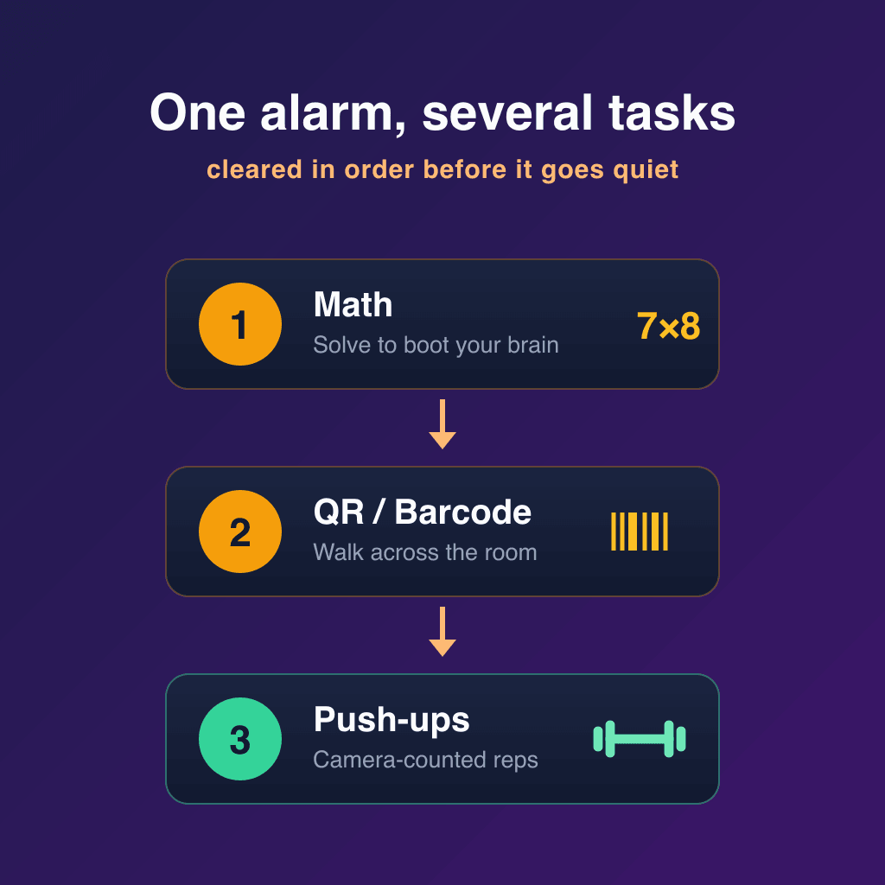

**Yes — Arisely is an Android alarm app that makes you do push-ups to turn it off, and it uses the
camera to verify every rep in real time.** You set a rep count, the alarm rings at full volume, and it
will not stop until the camera confirms you have finished. There is no tap-to-skip and no way to fake
the reps.

But push-ups are one of **ten missions**, and the right one depends on how you fail. This guide covers
the push-up mission first, then the other nine and when each is the better choice.

## Why a task beats a snooze button

The reason most alarms fail is not volume. It is **posture and reflex**.

Snooze asks for one thing: a sleepy tap. A brain in deep sleep is perfectly capable of providing that
tap and forgetting it happened — which is why people genuinely do not remember turning off alarms.
Worse, each snooze drops you into fragmented, low-quality sleep, so you wake groggier than if you had
gotten up on the first ring. The snooze button is optimised for staying asleep.

**Sleep inertia** — the grogginess right after waking — fades with *arousal*, either cognitive or
physical. A mission forces that arousal:

- **Cognitive missions** (maths, memory, typing, trivia, sequences) require focus and accuracy you
  cannot fake while drowsy.
- **Physical missions** (steps, shake, walking to a barcode, push-ups) get your body upright and your
  heart rate up.

Either way, by the time the alarm goes quiet, you are actually awake. The alarm has become a wake-up
*test* rather than a noise you can swat away.

## How the AI push-up mission works

1. **Set the mission.** When you create an alarm, choose the AI Push-Up Mission and pick a rep count —
   start low (3–5) and raise it as it gets easy.
2. **The alarm fires.** It rings on Android's dedicated alarm channel, at full volume, even if your
   media is muted or Do Not Disturb is on.
3. **Get into position.** Prop the phone against something, or lay it on the floor, so the front
   camera can see you.
4. **Do the reps.** On-device pose detection counts each valid push-up. Half-reps do not count.
5. **The alarm stops** only when the camera has confirmed the full count.

By the time you are done, your heart rate is up and you are off the mattress. That is the whole point.

## Why a physical mission beats every other "hard alarm"

| Alarm type | How you beat it half-asleep | Wakes your body? |
| :--- | :--- | :--- |
| Standard snooze | One tap | No |
| Loud-only alarm | Fumble for volume | No |
| Maths / typing mission | Mash numbers until it passes | Barely |
| Shake mission | Shake the phone in bed | No |
| Barcode across the room | Walk to it — effective | Yes |
| **AI push-up mission** | **You can't — the camera checks form** | **Yes** |

Maths and shake missions still let you stay in bed. **Maths wakes your brain for ten seconds; push-ups
wake your body.** If you have beaten puzzle alarms before by solving them half-asleep, that is the
signal to move to a physical mission.

## All 10 missions, and who each is for

| Mission | Type | Best for |
| :--- | :--- | :--- |
| Maths | Cognitive | Light sleepers who just need a nudge |
| Memory | Cognitive | A step up from maths |
| Code | Cognitive | Forcing careful attention |
| Sequence | Cognitive | Pattern focus |
| Typing | Cognitive | Accuracy under grogginess |
| Trivia | Cognitive | A more engaging wake-up |
| Shake | Physical | Light movement |
| Step | Physical | Getting out of bed |
| QR / Barcode | Physical | Forcing you across the room |
| AI Push-Up | Physical | The hardest — camera-verified reps |

Match the mission to your sleep. A quick maths problem may be enough on a light night; on a heavy one,
put a barcode across the room or set camera-verified push-ups so you cannot win without standing up.

Some mornings a workout is not realistic, and a wake-up tool that is too rigid gets uninstalled. Use
push-ups on gym days and a barcode scan on the rest.

## Chain several missions together

One mission is often enough, but a single task you have done a hundred times can turn into its own
half-asleep reflex. Arisely lets one alarm run several missions in order — say **Maths → QR/Barcode →
Push-Up** — each step with its own difficulty and number of rounds, and the alarm only dismisses once
you have cleared the whole chain. A cognitive task to boot your brain, then a physical one to get you
on your feet, is far harder to sleepwalk through than either alone.

A single mission stays free (one round, on Easy or Medium); chaining two or more missions is a Pro
feature. Alarms you already set keep working exactly as before — they simply become a one-step chain,
so nothing changes unless you add to it.

## Mission alarm vs standard alarm

| | Standard alarm | Mission alarm |
| :--- | :--- | :--- |
| **To silence** | One tap | Complete a task |
| **Beat it half-asleep?** | Easily | No |
| **Ends sleep inertia?** | No | Yes |
| **Snooze abuse** | Encouraged | Limited or removed |

## Privacy: the camera stays on your phone

A camera-based alarm raises a fair question: where does the video go? With Arisely, nowhere. There is
**no account**, and camera frames are **processed on your phone and never recorded, stored or sent**.
The pose detection that counts your reps runs on-device. The free version shows one banner ad outside
the ring screen; Arisely Pro removes it.

Worth applying that test to any camera-based alarm you consider: an app that cannot transmit anything
cannot leak footage of your bedroom, whatever its privacy policy says.

## Honest context

Arisely is a **new app** — 100+ downloads and no aggregate rating yet, against Alarmy's 50M+ downloads
and 4.7 stars. We make it, so weigh this section accordingly. If you want a large, proven mission
alarm, Alarmy and Alarm Clock Xtreme are the safer choices, and we compare all of them in
[best alarm apps for heavy sleepers](/blog/best-alarm-apps-for-heavy-sleepers-android-2026) and
[Alarmy alternatives](/blog/alarmy-alternatives-android). The camera-verified push-up mission is the
thing Arisely has that they do not.

One more thing worth ruling out first: if your alarm sometimes does not ring at all, no mission will
help. See [why Android alarms don't go off](/blog/why-android-alarms-dont-go-off-exact-alarms).

## Try it

Arisely is free on Google Play and needs no sign-up.

[**Download Arisely on Google Play**](https://play.google.com/store/apps/details?id=com.arisely&referrer=utm_source%3Dapplass%26utm_medium%3Dblog%26utm_campaign%3Dpushup-alarm%26utm_content%3Dalarm-app-that-makes-you-do-pushups-android)

---

**Related:** [What Arisely is and how the mission gate works](/blog/arisely-alarm-clock-for-heavy-sleepers) ·
[Best alarm apps for heavy sleepers](/blog/best-alarm-apps-for-heavy-sleepers-android-2026) ·
[Best Alarmy alternatives](/blog/alarmy-alternatives-android)
