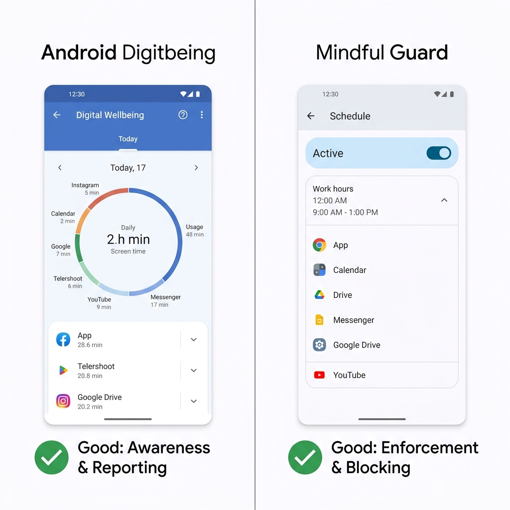
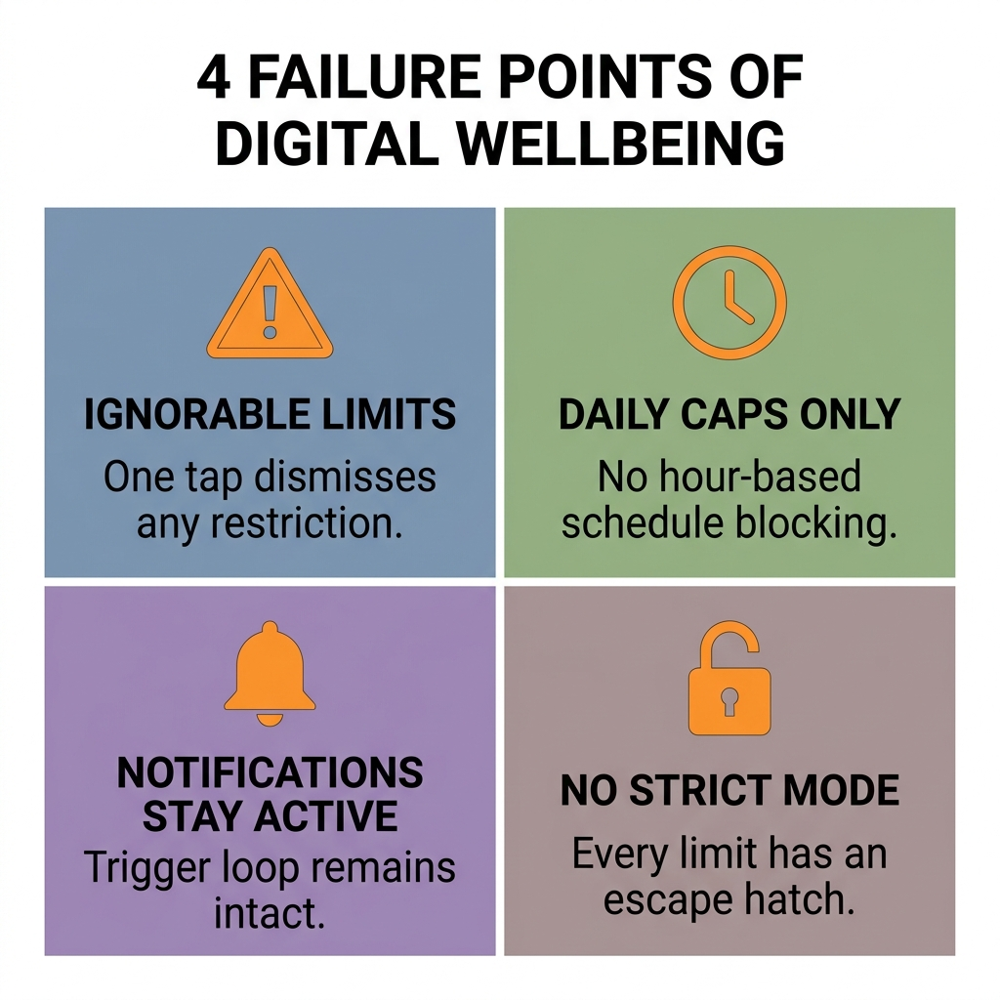
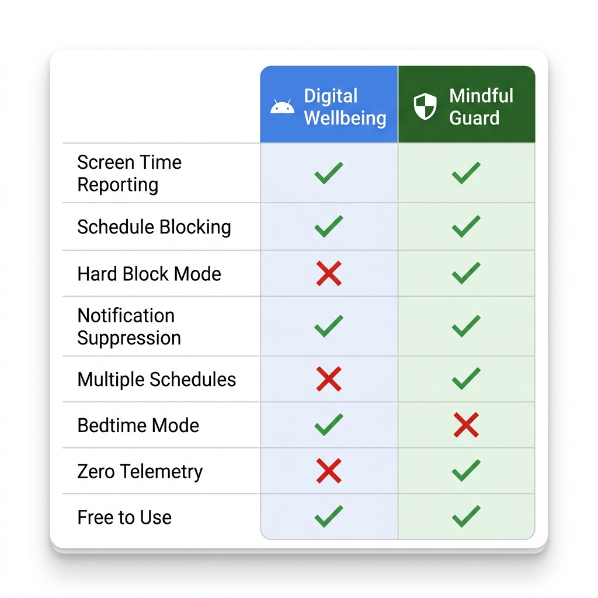

Cuando Android presentó el Bienestar digital en 2018, pareció el movimiento correcto. Una plataforma importante reconociendo que el tiempo de pantalla era un problema y construyendo herramientas para abordarlo directamente: eso era progreso.

Ocho años después, la valoración honesta es más complicada.

El Bienestar digital sigue ahí, sigue prácticamente igual y sigue funcionando sobre la misma premisa de diseño que causó problemas desde el principio: que la gente necesita sobre todo *información* sobre sus hábitos con el móvil, no *cumplimiento* de otros mejores.

Si alguna vez has puesto un límite diario de 30 minutos a Instagram, has visto aparecer la notificación al minuto 29 y has tocado «Ignorar por hoy», ya entiendes el hueco del que trata este artículo.

Esto no es un ataque al Bienestar digital. Hace algunas cosas genuinamente bien. Pero si estás leyendo esto, probablemente ya has intuido que no está resolviendo tu problema de concentración. Esta comparación te mostrará exactamente por qué, cómo es una alternativa más eficaz y cómo decidir qué herramienta —o qué combinación— encaja con tu situación.

---

## Lo que el Bienestar digital sí hace bien

Antes de entrar en las limitaciones, conviene ser justos con lo que el Bienestar digital ofrece de verdad.

**Los informes de tiempo de pantalla** son precisos y útiles. Los resúmenes semanales con tus apps principales, el uso diario total y la frecuencia de desbloqueos te dan datos reales sobre tus hábitos. Esa capa de concienciación tiene valor: no puedes cambiar un patrón que no ves.

**El modo Descanso** está infravalorado. La función que pasa la pantalla a escala de grises y silencia las notificaciones a partir de una hora es simple, eficaz y ayuda de verdad con el hábito de hacer scroll antes de dormir, que arruina la calidad del sueño de mucha gente.

**El modo Concentración** funciona bien para sprints de trabajo cortos e intencionados. Lo activas, eliges las apps bloqueadas y pones un temporizador. Para sesiones estructuradas tipo Pomodoro, en las que ya estás motivado y solo necesitas un empujón, es suficiente.

**La ausencia de fricción al configurarlo** es una ventaja real. El Bienestar digital viene preinstalado, no requiere permisos adicionales más allá de los que Android ya tiene, y casi cualquiera puede poner un límite de tiempo básico en menos de dos minutos.

Para quien solo quiere hacerse una idea general de cuánto tiempo pasa con el móvil y de vez en cuando quiere desconectar unas horas, el Bienestar digital está bien. El problema empieza cuando necesitas que haga algo más que eso.

---

---

## Dónde se queda corto el Bienestar digital

### El problema de «Ignorar por hoy»

Este es el fallo central del diseño del Bienestar digital, y viene de una decisión filosófica que en la práctica resulta equivocada.

El Bienestar digital trata el uso excesivo del móvil como un problema de concienciación. La premisa es: si sabes que has usado Instagram durante 30 minutos, elegirás parar. El botón «Ignorar por hoy» existe porque los diseñadores creían que el usuario debía conservar siempre el control último.

En teoría suena respetuoso con la autonomía del usuario. En la práctica significa que el sistema no tiene ningún poder real de cumplimiento. En el momento en que ves esa notificación y sientes el impulso de seguir haciendo scroll, el botón para saltárselo está justo ahí, y tocarlo exige menos esfuerzo mental que parar. Lo vas a tocar. Casi todo el mundo lo hace.

Esto no es un defecto de carácter. Es el resultado previsible de un sistema que exige fuerza de voluntad justo en el momento en que la fuerza de voluntad está más agotada.

### Límites de tiempo sin horarios

Los límites del Bienestar digital son topes diarios, no bloqueos por franja horaria. Tienes 30 minutos de Instagram al día, pero puedes gastarlos todos a las 7 de la mañana si quieres, dejando el resto del día sin nada que lo haga cumplir.

Lo que la mayoría necesita en realidad no es un tope diario, sino un bloqueo por ventana: Instagram no está disponible de 9:00 a 17:00, da igual cuánto o cuán poco lo hayas usado. Es una restricción radicalmente distinta, y el Bienestar digital no la ofrece.

### Las notificaciones siguen llegando

Incluso cuando una app ha llegado a su límite de tiempo, el Bienestar digital no bloquea sus notificaciones. Tu distintivo de Instagram sigue mostrando nuevos «me gusta». Tus notificaciones de Reddit siguen sonando. Las señales visuales y sonoras que disparan el hábito de abrir la app siguen plenamente activas, lo que significa que el bucle de tentación arranca aunque la app esté técnicamente restringida.

### Sin bloqueo firme

No hay ninguna configuración del Bienestar digital que haga los límites realmente imposibles de sortear. Toda restricción tiene una vía de escape. Para quien intenta en serio cambiar un hábito arraigado con el móvil, esto deja la herramienta funcionalmente inútil en los momentos más difíciles, que son exactamente los momentos en los que debería ayudar.

### Datos y privacidad

El Bienestar digital envía datos de uso a Google como parte del ecosistema más amplio de telemetría de Android. Para la mayoría esto es una preocupación menor, pero para quien se toma en serio la privacidad digital —o sencillamente no quiere que sus patrones de uso queden registrados y asociados a su cuenta de Google— es una consideración relevante.

---

---

## Cómo llena Mindful Guard ese hueco

Mindful Guard se construyó sobre una premisa de diseño distinta: que el problema no es la concienciación, sino la arquitectura. La gente suele saber que usa el móvil demasiado. Lo que necesita es un sistema que haga la distracción estructuralmente más difícil, no un panel que le muestre lo distraída que ha estado.

Así se traduce eso en la práctica, en las mismas dimensiones donde el Bienestar digital se queda corto.

### Bloqueos firmes por horario

Mindful Guard bloquea las apps por franja horaria, no por tope diario. Defines un horario —de 9:00 a 17:00, de lunes a viernes— y durante esa ventana las apps bloqueadas sencillamente no se abren. No hay notificación preguntando si quieres ignorarlo. No hay una cuota diaria que puedas gastar de golpe al principio. La ventana es la regla.

Esta es la diferencia más importante. Elimina la decisión por completo durante tus horas de concentración definidas, que es el único enfoque que funciona de forma fiable cuando la motivación está baja.

### Sin botón de salida

Cuando un bloqueo está activo, no hay ningún botón para saltárselo en la pantalla de bloqueo. La app sigue cerrada hasta que termina el horario o el temporizador. Suena severo, pero es lo que exige la concentración de verdad: un sistema que aguante la línea en tus peores días, no solo en los mejores.

### Supresión de notificaciones

Cuando Mindful Guard bloquea una app, sus notificaciones quedan suprimidas a la vez. Sin distintivos, sin sonidos, sin banners. El bucle disparador —notificación → impulso → abrir la app— se rompe en el primer paso, que es donde hay que romperlo.

### Arquitectura sin telemetría

Mindful Guard funciona por completo en el dispositivo. Usa el servicio de accesibilidad de Android para ver qué app está en primer plano, y la sección de Seguridad de los datos de Google Play indica que no recopila ni comparte datos. Nada sale de tu móvil. Para quien ya se preocupa por la privacidad, esta es una distinción significativa frente a una herramienta nativa de Google.

### Varios perfiles de horario

Puedes crear horarios distintos para contextos distintos: un bloqueo estricto por la mañana de 6:00 a 8:00, un bloqueo de trabajo de 9:00 a 17:00, un bloqueo más suave para desconectar por la noche. Cada horario tiene su propia lista de apps y su modo de bloqueo. Esa flexibilidad te permite ajustar el sistema a tu vida real en lugar de forzar tu vida dentro de un único límite diario.

### Modo Estricto

El único hueco que deja un «sin botón de salida» es el atajo por los ajustes: forzar la detención de la app, desactivar su permiso de accesibilidad o iniciar una desinstalación. El Modo Estricto lo cierra. Durante una sesión estricta, abrir la información de la app, la accesibilidad o la pantalla de desinstalación de Mindful Guard te devuelve atrás, sin opción de «abrir de todos modos»; para salir antes tocas «Desbloquear antes» y esperas 20 minutos, con el bloqueo activo todo ese tiempo. Esta es exactamente la capa de cumplimiento para la que el Bienestar digital no tiene equivalente. Tu primera sesión estricta es gratis; a partir de ahí es una función Premium.

### Bloqueo de sitios web

Bloquear una app ya no deja su web como vía de escape. Mindful Guard cubre automáticamente el sitio de una app bloqueada —bloquea la app de Facebook y facebook.com también queda bloqueado— y puedes añadir tus propios dominios. Un sitio bloqueado se abre en una página en blanco con una pantalla de pausa en lugar de cargar y, como la pestaña del navegador se redirige en el propio dispositivo, no hay ninguna VPN de por medio.

---

## Comparación directa

| Función | Bienestar digital | Mindful Guard |
|---|---|---|
| Informes de tiempo de pantalla | ✅ Sí | ❌ No |
| Bloqueo por horarios | ❌ No | ✅ Sí |
| Bloqueo firme (sin salida) | ❌ No | ✅ Sí |
| Modo Estricto (cierra el atajo por ajustes) | ❌ No | ✅ Sí |
| Bloqueo de sitios web (sin VPN) | ❌ No | ✅ Sí |
| Supresión de notificaciones | ❌ No | ✅ Sí |
| Varios perfiles de horario | ❌ No | ✅ Sí |
| Modo Descanso / escala de grises | ✅ Sí | ❌ No |
| Sin telemetría | ❌ No | ✅ Sí |
| Preinstalado | ✅ Sí | ❌ Hay que instalarlo |
| Gratis | ✅ Sí | ✅ Plan gratuito |

El patrón está claro: el Bienestar digital gana en concienciación y comodidad. Mindful Guard gana en cumplimiento y privacidad. Están resolviendo problemas distintos.

---

---

## ¿Cuál deberías usar?

La respuesta depende de en qué punto estés con tus hábitos de móvil.

**Usa el Bienestar digital si:**
- Quieres una idea básica de tu tiempo de pantalla sin instalar nada nuevo
- Tu uso del móvil te parece manejable y solo quieres empujoncitos suaves de vez en cuando
- Lo que más necesitas es el modo Descanso o la escala de grises para dormir mejor
- Nunca has probado una herramienta de concentración y quieres empezar sin fricción

**Usa Mindful Guard si:**
- Has probado los límites de tiempo del Bienestar digital y te has visto ignorándolos
- Necesitas que las apps estén realmente no disponibles durante ciertas horas de trabajo
- Quieres supresión de notificaciones además de bloqueo de apps
- La privacidad te importa y prefieres una arquitectura sin telemetría
- Has probado los enfoques basados en fuerza de voluntad y no han aguantado

**Usa ambos si:**
- Quieres el panel de informes del Bienestar digital para la concienciación pasiva
- Y el cumplimiento por horarios de Mindful Guard para la protección activa de tu concentración

Esta es en realidad la configuración más completa. El Bienestar digital te cuenta qué está pasando con tu tiempo de pantalla a lo largo del tiempo. Mindful Guard evita que lo peor ocurra durante tus horas más importantes. No se solapan: se complementan.

---

## La conclusión honesta

El Bienestar digital es una herramienta bienintencionada que resuelve el problema equivocado. Da por hecho que necesitas información. La mayoría de quienes luchan con la distracción del móvil ya tienen esa información: saben que pasan demasiado tiempo en el móvil, saben qué apps son el problema y saben cuándo ocurre. Lo que les falta es un sistema que sostenga el límite cuando su yo del momento no quiere hacerlo.

Mindful Guard es ese sistema. No sustituye las funciones de informes del Bienestar digital, pero en la parte que de verdad importa —mantenerte lejos de las apps que distraen durante las horas en que tu concentración vale más— hace lo que el Bienestar digital no puede.

El objetivo no es encontrar la app perfecta. Es construir un entorno en el que el trabajo concentrado sea el camino de menor resistencia. Estas dos herramientas, usadas juntas, te acercan más a ese entorno que cualquiera de las dos por separado.

> **¿Listo para añadir cumplimiento real a tu configuración de concentración?** [Mindful Guard](https://play.google.com/store/apps/details?id=com.anonymous.mindfulguard&referrer=utm_source%3Dapplass%26utm_medium%3Dblog%26utm_campaign%3Dandroid-digital-wellbeing-vs-third-party-focus-apps%26utm_content%3Dinline) es gratis, no requiere cuenta y se configura en menos de 5 minutos. Cero datos recopilados. Todo en el dispositivo.
>
> **[Descarga Mindful Guard gratis en Google Play →](https://play.google.com/store/apps/details?id=com.anonymous.mindfulguard&referrer=utm_source%3Dapplass%26utm_medium%3Dblog%26utm_campaign%3Dandroid-digital-wellbeing-vs-third-party-focus-apps%26utm_content%3Dinline)**

---

**Relacionado:** ahora que conoces las herramientas, lee cómo [bloquear las redes sociales en Android solo en horario laboral](/blog/how-to-block-social-media-on-android-during-work-hours/) (en inglés) para una guía paso a paso que pone Mindful Guard a trabajar de inmediato.
